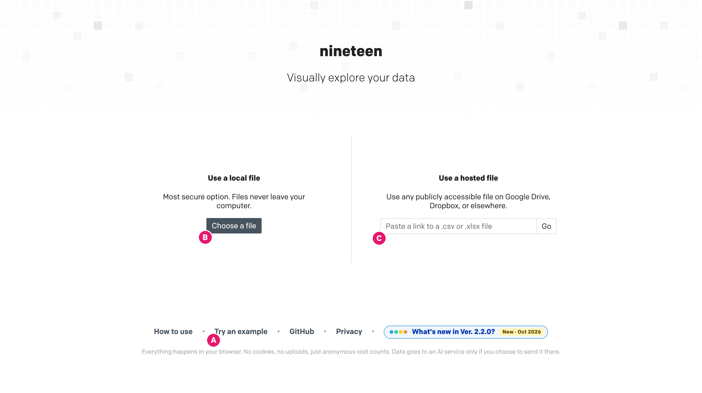
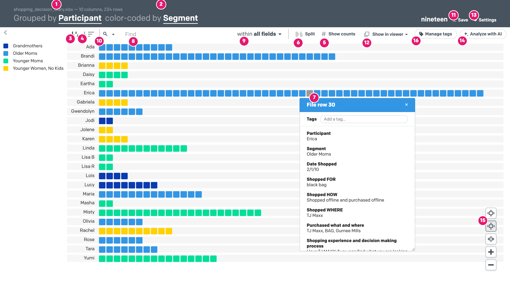
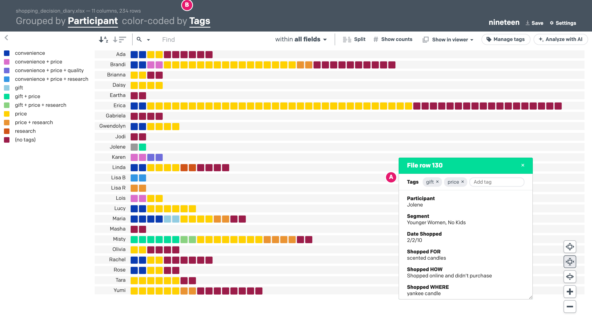
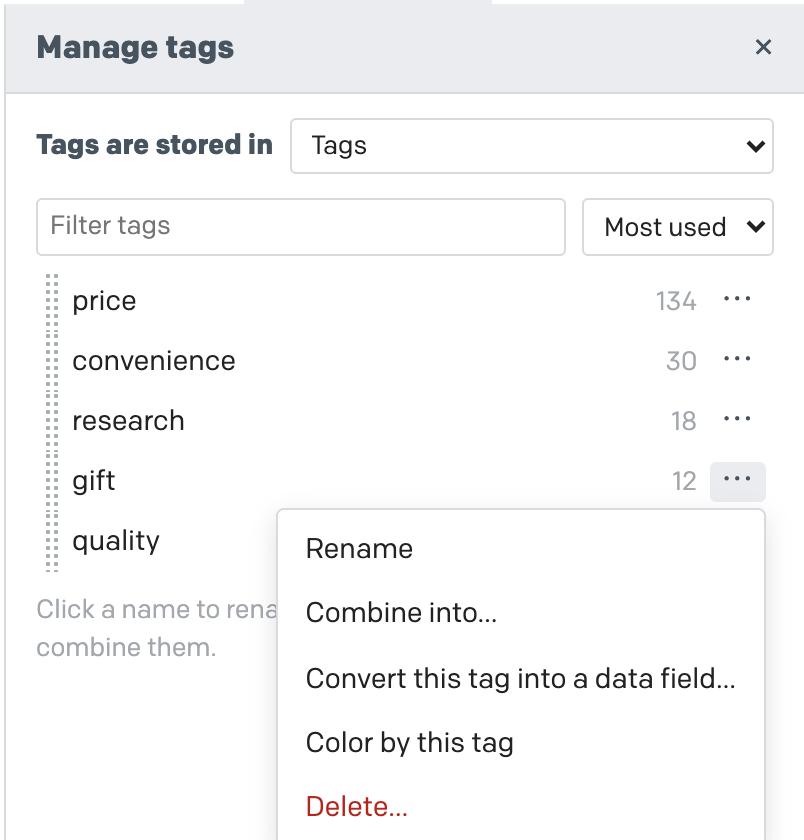
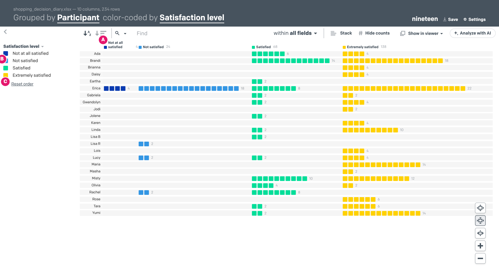
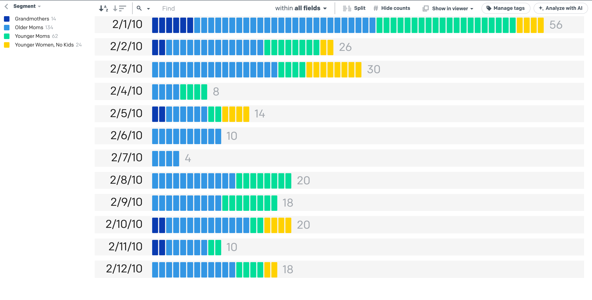
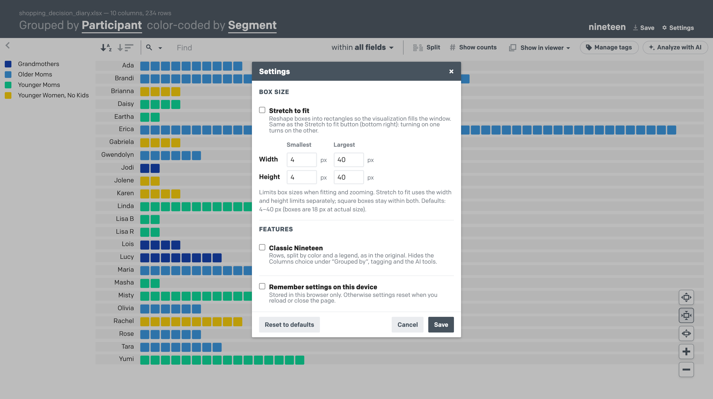
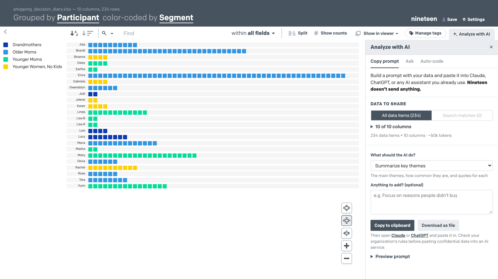

# Nineteen
### Nineteen is a qualitative data visualization app that turns .xlsx & .csv files into interactive visual tools

Nineteen runs entirely in your web browser. Your data is never uploaded anywhere.

### Basic Usage
New users may find it helpful to use the "Try an example" link (A) at the bottom of [Nineteen's main page](https://usenineteen.com) first,
before reading more here.

**Loading data:** The simplest way to start is to pick a file from your computer with the "Choose a file" (B) button on
[Nineteen's main page](https://usenineteen.com). You can also paste a link to a file hosted on Google Drive, Dropbox or elsewhere (C).
Each row of your data file becomes a data item, shown as a square in Nineteen's visualization.



**Data files: a few quick guidelines**
- For Excel workbooks (.xlsx and .xls files), Nineteen only reads the *first* worksheet/tab
- Comma- or tab-separated files (.csv, .tsv) work too
- Put the field names in the first row, one per spreadsheet column (e.g. "Participant", "Segment", "Date", "Description").
  Nineteen calls these *fields*; "rows" and "columns" below mean the rows and columns of the visualization
- After the first row, each line becomes an individual data item, shown as a square in Nineteen's visualization
- See "A Usable Example" below for an actual data file and the visualization it produces

**You can control how data is displayed using two primary controls: grouping and color-coding**
- Use the "group by" option (1) to organize your data into rows by a field, such as participant, and, if you like, into columns
  by another (see "Rows, Columns and Color" below)
- Use the "color by" option (2) to show, through color-coding, how the values in another field are spread across your groups
- For example, you can group your data by participant (field 1), then color-code it by segment (field 2)



### A Usable Example
- **Try a demo from the main page of Nineteen:** Click the "Try an example" link (A) on [Nineteen's main page](https://usenineteen.com)
- **See the example file:** You can download a copy of the [data file](public/shopping_decision_diary_extended.xlsx?raw=true) used for the example

### Additional Features to Discover
Nineteen never changes your data, so feel free to explore the interface. Additional features include:
- **Sorting:** Sort the rows alphabetically (3) or by the number of items in each group (4). Click a sort button again to reverse it
- **Reordering rows:** Drag a row's label up or down (a grip appears when you point at it; the whole row moves with you), or focus
  it and press Alt + ↑/↓, to put rows in your own order, such as
  *Not at all satisfied → Extremely satisfied*. The alphabetical sort button (3) then shows a ★, and cycles A–Z → Z–A → ★ (your
  order). Each field keeps its own order until you open another file
- **Counting:** The "Show counts" button (5) shows how many items are in each group
- **Splitting:** Once you've chosen a "color by" field, the "Split" button (6) separates each row into color bands
  (see "Split View and the Legend" below)
- **Detailed viewer:** Hover over any item in the visualization to see all of the data from that row of your file (7):
	- Click the item to pin its viewer open (click it again to un-pin it)
	- You can have several viewers open at once. Drag them by their title bar to arrange them, and drag the corner to resize them
	- The "Show in viewer" menu (12) controls which fields the viewer shows
	- Links in your data become clickable, and links to images are shown as images
- **Search:** The search bar (8) is directly above the visualization:
	- Items that match your search stay in color. Everything else turns gray. Matching text is highlighted in the viewers
	- The search box shows how many data items match ("23 of 293"), with **Tag these…** to tag them all at once (see "Tagging Your Data")
	- Search in one or more fields (9). By default search looks in all of them, but you can limit it
	- Multi-word searches:
		- Searching for *dog food* finds items containing 'dog' *or* 'food' (either word is enough)
		- *Hint:* to find *only* the word 'food' and not longer words like 'foodie', search for " food " (with quotes and spaces)
		- Searching for *"dog food"* (with quotes) finds only items containing the phrase "dog food"
		- Searching for *dog AND food* ('AND' must be capitalized) finds only items containing both "dog" and "food", though not necessarily together
		- An asterisk matches any single character: *re\*d* matches both "read" and "reed"
	- The drop-down (10) in the search bar lists the most frequent words. Click one to search for it, or shift-click to add it with AND
- **Find by meaning:** The "by text" button next to the search box switches the search to **by meaning**. Then a search like
  *worried about the price* finds the data items with a sentence that means something similar, in whatever words they use
  ("the cost was more than I'd planned on"), plus any that contain the exact phrase as whole words. The viewer says why each one
  matched: its rank ("#3 closest in meaning") and the sentence it matched by, which is highlighted, or "Contains" for a phrase hit:
	- Nineteen shows the 20 closest data items. In the "by meaning" menu, change that number, or show every data item with at
	  least a chosen similarity score (0 to 1; the viewer shows each match's score, and the menu suggests a cut-off for the model)
	- **Find similar** in a pinned viewer finds the data items closest in meaning to that one
	- Meaning is judged by a small language model that runs inside your browser. The first time, Nineteen asks before your browser
	  downloads it (about 70 MB) from Hugging Face; it is kept for next time, and Settings can remove it. Your data never leaves your
	  browser. A model for English is the default; Settings offers a multilingual one (about 250 MB)
	- Finding by meaning isn't in saved HTML files, which have only the text search
- **Zoom:** Use the buttons in the lower right (15) to return to actual size, fit the visualization to the window, stretch it to fit
  (see "Fitting the View" below), or zoom in and out
- **Save (11):** Save a standalone HTML file or a PNG image of the visualization, or download the data itself
  (see "Saving and Downloading" below)
- **Settings (13)**, **Analyze with AI (14)** and **Manage tags (16)** are described below

### Tagging Your Data
Pin a viewer (click an item) to tag that data item (A). Type a tag and press Enter or a comma, pick an existing tag from the suggestions,
or click × to remove one. The tag box stays at the top of the viewer while you scroll through a long entry, so you can tag as you
read. Tags are kept in a "Tags" field, created the first time you tag a data item and sorted alphabetically, so they are saved with
your spreadsheet, CSV and HTML downloads.



- **Tagging search results:** Search, and the search box shows how many data items match. Choose **Tag these…** there to add a tag
  to every match at once.
  If your search is itself a tag, you can also remove it from the matches. **Undo** reverses the change, and **Color by this tag**
  shows the tagged data items against the rest
- **Manage tags (16)** in the toolbar lists every tag with how many data items have it. Click a name to rename
  it. Drag one tag onto another, or use **Combine into…**, to merge them (renaming onto an existing tag does the same). **Delete**
  removes a tag from every data item, after asking, and **Color by this tag** shows its data items against the rest. Every change
  can be undone

  

- **Convert a tag into a data field:** In Manage tags, **Convert this tag into a data field** replaces the tag with a field (a
  column in your downloaded spreadsheet) that is True for the data items that had the tag and False for the rest, ready for Excel, R
  or SPSS. Tick
  **Keep the tag too** to keep both; the field then won't follow later tag changes. Undo reverses the whole conversion
- **Grouping and coloring by tags:** Group or color by Tags (B) and data items are grouped by their *combination* of tags ("gift + price"),
  ignoring order and capitalization. Every data item still gets exactly one box
- **List display options…** (in the Group by and Color by menus, and in Manage tags) lets you leave some tags out of the
  combinations, or show only one tag. Your data keeps every tag; only the grouping changes
- **Finding tags:** Click a tag in a viewer to find every data item with that tag. In tag fields, search matches whole tags, so
  "price" doesn't find "pricey"
- **Tag list and descriptions:** Manage tags lists every tag with its count, and the line under each one holds its description:
  click it to write what the tag means (untick *Descriptions* above the list for a compact view). Descriptions appear beside the
  suggestions when you tag, and the AI tools are told what the tags mean. The tag list can hold tags no data item carries yet, so a team can agree on the tagging options first:
  **Import…** at the bottom of Manage tags reads a list (CSV, JSON or a text file with one tag per line, with an optional
  description column), **New tag** adds one by name, and **Export as** CSV, JSON or Text writes the current list with counts. Tags keep their spelling but
  match regardless of case; importing never removes a tag from your data

### Fields that Hold Lists
Tags are one kind of list. Any field whose cells hold several values, like "Target, Walmart", can be treated the same way: choose
**"[field]" holds lists of values** in the Group by or Color by menu. Data items are then grouped by their combination of values,
search matches whole values, and the viewer shows each value separately.

- **Split values on:** values are split on commas or semicolons by default. If your values contain commas themselves (like
  "Younger Women, No Kids"), choose semicolons or new lines instead
- **Use "[field]" for tags:** tags are stored in a field named "Tags" unless you choose another one, for example a "Codes" field
  from an earlier round of coding. You can also choose it at the top of Manage tags. The viewer's tag box, **Tag these…** and
  Manage tags all write to that field

### Rows, Columns and Color
"Grouped by" (1) sets the rows and, if you like, the columns: pick a field under **Rows**, under **Columns**, or one under each.
With both, every row is split into a column per value of the second field, and a label row above the columns (A) shows each value
and, with
counts on, its total. The title reads "Grouped by Participant and Date Shopped". With columns only (Rows set to *None*), each
column collects its data items in a compact grid. Color is a third, independent choice (2), so a view can show each participant's
entries by date, colored by satisfaction.

**Stack** in the toolbar (6) takes the columns away and **Split** brings them back. With no columns chosen yet, Split uses the
"color-coded by" field, which is what Split always did. While stacked, the Columns choice reads *None*. Column labels carry a color
swatch when the columns are the color field's values. Long labels wrap onto up to 3 lines. If only a few columns are too narrow
even for that, just those get a little wider. If many are, all the
labels turn 90° together.



- **Reordering the legend:** Drag legend entries up or down by their grip (B), or focus one and press Alt + ↑/↓, to put values in a
  meaningful order (the label moves with you; colors stay with their positions), such as *Not at all satisfied → Extremely satisfied*. Colors are reassigned in the new order, split bands
  follow it, and rows grouped by the same field take on that order too. "Reset order" (C) puts it back

### Fitting the View: Square or Stretched Boxes
Boxes don't have to be square. **Stretch to fit** (in the zoom controls, 15) reshapes them into wider or taller rectangles so the
whole visualization fills the window, and they resize automatically as you resize the window or regroup your data.
Settings (13) lets you set the smallest and largest box width and height, and start every file stretched (see below).
When the layout changes, boxes glide to their new places; above 3,000 data items they move directly instead, which keeps large
files quick.



**Best fit** does the same with square boxes. Both stay on as you resize or regroup, until you zoom in or out yourself
or click the button again.

**Settings (13)** controls box sizes:



- *Classic Nineteen* (at the top, off by default) keeps to rows, Split by color and a legend, as in the original: the Columns choice under
  "Grouped by", tagging, finding by meaning and the AI tools are hidden
- *Stretch to fit* is the same switch as the Stretch to fit button: turning on one turns on the other. With *Remember settings*
  on, files you open later start stretched too
- *Smallest* and *largest* width and height (4–40 px by default) limit box sizes when fitting and zooming. Stretch to fit uses the
  width and height limits separately; square boxes stay within both
- *Find by meaning* chooses the model that judges meaning: *bge-small* for English (the default) or *multilingual-e5-small* for
  about 100 languages, with each one's download size. It also lists the models this browser has downloaded, with *Remove*
- Tick *Remember settings on this device* to keep your settings in this browser
- Changes preview as you make them. *Save* keeps them; *Cancel*, Esc or clicking outside the dialog discards them

### Saving and Downloading
The Save menu (11) offers:
- **Download HTML file:** a single standalone file with your data and current view built in. It opens in any browser, works offline,
  and stays fully interactive
- **Download PNG image:** a picture of the full visualization, including the parts scrolled out of view
- **Download spreadsheet (.xlsx)** and **Download CSV:** your data, including any fields added in Nineteen, such as tags or
  AI auto-coding

### Analyze with AI (optional)
The **Analyze with AI** button (14) opens a panel with three tools. At the top, **Data to share** sets exactly what any of them
can see: all data items or only your current search matches, and which fields. Untick names or other personal details there.



- **Copy prompt:** Pick a ready-made analysis (key themes, comparing groups, representative quotes, a coding scheme,
  an executive summary, or your own question). Then copy the prompt, with your data, to paste into Claude, ChatGPT or any
  assistant you already use, or download it as a file. **Nineteen sends nothing.**
- **Ask:** Chat about your data using your own Anthropic (Claude) or OpenAI (ChatGPT) API key. Answers cite data items by
  their row in your file, like [Row 12]. Click a citation to highlight those items in the visualization and open their viewer
- **Auto-code:** Have the AI assign every data item to one of your categories, or let it suggest categories first. The result
  is added as a new field (with an optional "reason" field), so you can group, color, split and search by it like any other.
  AI coding can be wrong, so spot-check it in the viewer

Ask and Auto-code send the shared data directly from your browser to the provider you chose, with your key. Nothing goes
through a Nineteen server. The first time in each session, Nineteen asks you to confirm before sending anything. Your key
stays in memory unless you choose to remember it on this device. Claude requests use `claude-opus-5-5` by default.
You can pick any model your key can use.

### A Note About Data Privacy
All data processing happens in your browser. Your data never reaches a server, so your research stays *your research*.
You can use Nineteen with confidential data.

- **No cookies, only anonymous visit counts.** Nineteen sets no cookies and uses no advertising or cross-site tracking.
  usenineteen.com counts visits with Cloudflare Web Analytics, which stores nothing on your device and never sees your
  data (page, referrer, browser and country only). The visualization has its own address, `/visualize`, and the example
  `/example`, so the counts can tell the front page from actual use; nothing about your file is ever in the address. Saved
  HTML files contain no analytics
- **AI is opt-in.** Data reaches an AI provider only when you press Send or Code in the AI panel, after confirming. It goes
  straight from your browser to Anthropic or OpenAI
- **Finding by meaning happens in your browser.** The language model behind it is downloaded from Hugging Face once, after
  asking you, and kept in your browser's cache storage (Settings can remove it). Hugging Face sees the download the way any site
  sees one, and never your data: the model reads your data on your own computer
- **Remembered settings and keys are opt-in.** Display settings and AI keys are stored in this browser's local storage only
  if you tick "Remember … on this device"
- **Session storage only.** While a file is open, a copy of it and of your view settings is kept in your browser's session storage so both survive a reload.
  Your browser deletes it when you close the tab
- **Hosted files** are downloaded directly by your browser from the site you link to. Some sites (often Google Drive) don't allow this,
  and Nineteen will tell you so. In that case, download the file and use "Choose a file" instead
- **Saved files** are created in your browser and saved straight to your computer. A saved HTML file contains your data, so share it carefully

The app enforces this with a strict Content Security Policy: the only code allowed to run is the code that ships with the app
(including the model runtime it serves itself), plus Cloudflare's analytics script on usenineteen.com.

## Have More Questions?
Email [Ted Pollari](mailto:ted@pollari.org?subject=Nineteen) and/or [Kim Erwin](mailto:kerwin@id.iit.edu?subject=Nineteen), the creators of Nineteen. We'd also love to hear how you're using Nineteen, if you find it useful!

## Development

Nineteen is a static site built with [Svelte 5](https://svelte.dev), TypeScript and [Vite](https://vite.dev).
Spreadsheets are read with [SheetJS](https://sheetjs.com) and CSV files with [Papa Parse](https://www.papaparse.com).
It has no server component.

```bash
npm install
npm run dev       # local development server
npm test          # unit tests (parsing, search, sentence splitting and scoring, layout, colors, links, persistence)
npm run check     # type checking
npm run build     # production build → dist/
```

`npm run build` produces `dist/index.html`, the entire app in a single self-contained file (code, styles, fonts and icons inlined),
plus `dist/shopping_decision_diary_extended.xlsx` for "Try an example". Any static host works (GitHub Pages, Cloudflare Pages, Netlify, S3, …).
The single-file build also powers "Download HTML file": a saved copy is the same page with the data embedded.
"Find by meaning" is the one part kept outside that file: its worker (`dist/worker-*.js`) and the ONNX runtime it runs the model
with (`dist/ort/`) are served next to the app, and the model itself is downloaded from Hugging Face on first use.
`public/_headers` sets the cross-origin isolation headers on usenineteen.com so the runtime can use threads where there is no WebGPU.

`dist/` is committed, so the repository always contains a working copy of the app. A pre-commit hook (`.githooks/pre-commit`)
rebuilds it and stages it before every commit; `npm install` turns the hook on. The README screenshots are in `docs/screenshots/`.

SheetJS is installed from the official SheetJS CDN, because the `xlsx` package on npm is no longer updated and has known vulnerabilities.

### Project layout

| Path | Contents |
| --- | --- |
| `src/lib/` | Framework-free logic: file parsing, value/date interpretation, search, layout, palette, persistence, PNG and HTML export |
| `src/lib/ai/` | AI features: data packaging, prompt templates, answer/citation parsing, auto-coding, provider clients (Anthropic SDK, OpenAI REST) |
| `src/lib/semantic/` | Find by meaning: the embedding worker ([Transformers.js](https://huggingface.co/docs/transformers.js)), sentence splitting and scoring, the model catalog |
| `src/components/` | Svelte UI: import page, visualization, legend, toolbar, dropdowns, viewer popups |
| `src/styles/app.css` | Styles ported from the original Stylus sources |
| `test/` | Vitest suite, including the search cases from the original test suite |
| `dist/` | The built app, committed (see above) |
| `docs/` | README screenshots and a summary of what's new |

### What changed in the browser-only rewrite
- No Node/Express server: uploads, hosted-file downloads, the example and "Save" all happen in the browser
- Replaced Backbone/Marionette, jQuery, d3 v3, Browserify, Babel 6, html2canvas and Modernizr with Svelte 5 + Vite
- Up-to-date, patched spreadsheet parser; locked-down Content Security Policy; no cookies
- PNG export works again (drawn natively instead of screen-captured)
- Standalone HTML export is a single file instead of a zip, and it restores the full view (including search)

## A Note of Thanks
Nineteen started as Ted Pollari's graduate project at the [Institute of Design at Illinois Tech](http://id.iit.edu),
with the guidance and collaboration of Kim Erwin and additional support from Matt Mayfield.

In 2015, the Knight Foundation generously provided a grant from the Knight Prototype Fund, which paid for a complete rewrite of the app.
We are deeply indebted to them for their support.

In 2026, Nineteen was rebuilt to run entirely in the browser, with help from Claude, Anthropic's AI assistant.

Lastly, Nineteen wouldn't be what it is without significant work from these Institute of Design students:
Courtney Garland, David LaPorte, Brewer Palmer, and Mark Supert.
