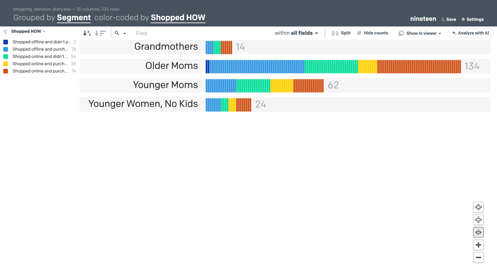

# Nineteen
### Nineteen is a qualitative data visualization app that turns .xlsx & .csv files into interactive visual tools

Nineteen runs entirely in your web browser. Your data is never uploaded anywhere.

### Basic Usage
New users may find it helpful to use the "Try an example" link (A) at the bottom of [Nineteen's main page](https://usenineteen.com) first,
before reading more here.

**Loading data:** The simplest way to start is to pick a file from your computer with the "Choose a file" (B) button on
[Nineteen's main page](https://usenineteen.com). You can also paste a link to a file hosted on Google Drive, Dropbox or elsewhere (C).
Each row of your data file becomes a data item, shown as a square in Nineteen's visualization.


**Data files: a few quick guidelines**
- For Excel workbooks (.xlsx and .xls files), Nineteen only reads the *first* worksheet/tab
- Comma- or tab-separated files (.csv, .tsv) work too
- Put column headers/names in the first row (e.g. "Participant", "Segment", "Date", "Description")
- After the first row, each line becomes an individual data item, shown as a square in Nineteen's visualization
- See "A Usable Example" below for an actual data file and the visualization it produces

**You can control how data is displayed using two primary controls: grouping and color-coding**
- Use the "group by" option (1) to organize your data by a single column, such as participant
- Use the "color by" option (2) to show, through color-coding, how the values in another column are spread across your groups
- For example, you can group your data by participant (column 1), then color-code it by segment (column 2)


### A Usable Example
- **Try a demo from the main page of Nineteen:** Click the "Try an example" link (A) on [Nineteen's main page](https://usenineteen.com)
- **See the example file:** You can download a copy of the [data file](public/shopping_decision_diary.xlsx?raw=true) used for the example

### Additional Features to Discover
Nineteen never changes your data, so feel free to explore the interface. Additional features include:
- **Sorting:** Sort the rows alphabetically (3) or by the number of items in each group (4). Click a sort button again to reverse it
- **Counting:** The "Show counts" button (5) shows how many items are in each group
- **Splitting:** Once you've chosen a "color by" column, the "Split" button (6) separates each row into color bands
  (see "Split View and the Legend" below)
- **Detailed viewer:** Hover over any item in the visualization to see all of the data from that row of your file (7):
	- Click the item to pin its viewer open (click it again to un-pin it)
	- You can have several viewers open at once. Drag them by their title bar to arrange them, and drag the corner to resize them
	- The "Show in viewer" menu (12) controls which columns the viewer shows
	- Links in your data become clickable, and links to images are shown as images
- **Text search:** The search bar (8) is directly above the visualization:
	- Items that match your search stay in color. Everything else turns gray. Matching text is highlighted in the viewers
	- Search in one or more columns (also called "fields") (9). By default search looks in all of them, but you can limit it
	- Multi-word searches:
		- Searching for *dog food* finds items containing 'dog' *or* 'food' (either word is enough)
		- *Hint:* to find *only* the word 'food' and not longer words like 'foodie', search for " food " (with quotes and spaces)
		- Searching for *"dog food"* (with quotes) finds only items containing the phrase "dog food"
		- Searching for *dog AND food* ('AND' must be capitalized) finds only items containing both "dog" and "food", though not necessarily together
		- An asterisk matches any single character: *re\*d* matches both "read" and "reed"
	- The drop-down (10) in the search bar lists the most frequent words. Click one to search for it, or shift-click to add it with AND
- **Zoom:** Use the buttons in the lower right (15) to return to actual size, fit the visualization to the window, stretch it to fit
  (see "Fitting the View" below), or zoom in and out
- **Save (11):** Save a standalone HTML file or a PNG image of the visualization, or download the data itself
  (see "Saving and Downloading" below)
- **Settings (13)** and **Analyze with AI (14)** are described below

### Tagging Your Data
Pin a viewer (click an item) to tag that row (A). Type a tag and press Enter or a comma, pick an existing tag from the suggestions,
or click × to remove one. Tags are kept in a "Tags" column, created the first time you tag a row and sorted alphabetically, so they
are saved with your spreadsheet, CSV and HTML downloads.


- **Grouping and coloring by tags:** Group or color by Tags (B) and rows are sorted by their *combination* of tags ("gift + price"),
  ignoring order and capitalization. Every row still gets exactly one box
- **Tag options…** (in the Group by and Color by menus) lets you leave some tags out of the combinations, or show only one tag.
  Your data keeps every tag; only the grouping changes
- **Finding tags:** Click a tag in a viewer to find every row with that tag. In tag columns, search matches whole tags, so
  "price" doesn't find "pricey"
- **Your own tag columns:** Any column can be treated as tags by choosing "holds comma-separated tags" in the Group by or Color by menus

### Split View and the Legend
With Split on, each value of the "color by" column gets its own band, and a label row above the bands (A) shows each value and,
with counts on, its total. Long labels wrap onto up to 3 lines. If only a few bands are too narrow even for that, just those bands
get a little wider. If many are, all the labels turn 90° together.


- **Reordering the legend:** Drag legend entries up or down by their grip (B), or focus one and press Alt + ↑/↓, to put values in a
  meaningful order, such as *Not at all satisfied → Extremely satisfied*. Colors are reassigned in the new order, split bands
  follow it, and rows grouped by the same column follow it when sorted A–Z. "Reset order" (C) puts it back
- **Legend title:** The name above the legend (16, in the main screenshot) is the column the colors stand for. Click it to change it

### Fitting the View: Square or Stretched Boxes
Boxes don't have to be square. **Stretch to fit** (in the zoom controls, 15) reshapes them into wider or taller rectangles so the
whole visualization fills the window, and they resize automatically as you resize the window or regroup your data.
Settings (13) lets you set the smallest and largest box width and height, and start every file stretched (see below).



**Best fit** does the same with square boxes. Both stay on as you resize or regroup, until you zoom in or out yourself
or click the button again.

**Settings (13)** controls box sizes:


- *Stretch to fit* is the same switch as the Stretch to fit button: turning on one turns on the other. With *Remember settings*
  on, files you open later start stretched too
- *Smallest* and *largest* width and height (4–40 px by default) limit box sizes when fitting and zooming. Stretch to fit uses the
  width and height limits separately; square boxes stay within both
- Tick *Remember settings on this device* to keep your settings in this browser
- Changes preview as you make them. *Save* keeps them; *Cancel*, Esc or clicking outside the dialog discards them

### Saving and Downloading
The Save menu (11) offers:
- **Download HTML file:** a single standalone file with your data and current view built in. It opens in any browser, works offline,
  and stays fully interactive
- **Download PNG image:** a picture of the full visualization, including the parts scrolled out of view
- **Download spreadsheet (.xlsx)** and **Download CSV:** your data, including any columns added in Nineteen, such as tags or
  AI auto-coding

### Analyze with AI (optional)
The **Analyze with AI** button (14) opens a panel with three tools. At the top, **Data to share** sets exactly what any of them
can see: all rows or only your current search matches, and which columns. Untick names or other personal details there.


- **Copy prompt:** Pick a ready-made analysis (key themes, comparing groups, representative quotes, a coding scheme,
  an executive summary, or your own question). Then copy the prompt, with your data, to paste into Claude, ChatGPT or any
  assistant you already use, or download it as a file. **Nineteen sends nothing.**
- **Ask:** Chat about your data using your own Anthropic (Claude) or OpenAI (ChatGPT) API key. Answers cite rows like
  [Row 12]. Click a citation to highlight those items in the visualization and open their viewer
- **Auto-code:** Have the AI assign every row to one of your categories, or let it suggest categories first. The result
  is added as a new column (with an optional "reason" column), so you can group, color, split and search by it like any other.
  AI coding can be wrong, so spot-check it in the viewer

Ask and Auto-code send the shared data directly from your browser to the provider you chose, with your key. Nothing goes
through a Nineteen server. The first time in each session, Nineteen asks you to confirm before sending anything. Your key
stays in memory unless you choose to remember it on this device. Claude requests use `claude-opus-5-5` by default.
You can pick any model your key can use.

### A Note About Data Privacy
All data processing happens in your browser. Your data never reaches a server, so your research stays *your research*.
You can use Nineteen with confidential data.

- **No cookies, no tracking.** Nineteen sets no cookies and loads no analytics or third-party scripts
- **AI is opt-in.** Data reaches an AI provider only when you press Send or Code in the AI panel, after confirming. It goes
  straight from your browser to Anthropic or OpenAI
- **Remembered settings and keys are opt-in.** Display settings and AI keys are stored in this browser's local storage only
  if you tick "Remember … on this device"
- **Session storage only.** While a file is open, a copy is kept in your browser's session storage so the view survives a reload.
  Your browser deletes it when you close the tab
- **Hosted files** are downloaded directly by your browser from the site you link to. Some sites (often Google Drive) don't allow this,
  and Nineteen will tell you so. In that case, download the file and use "Choose a file" instead
- **Saved files** are created in your browser and saved straight to your computer. A saved HTML file contains your data, so share it carefully

The app enforces this with a strict Content Security Policy: the only code allowed to run is the code that ships with the app.

## Have More Questions?
Email [Ted Pollari](mailto:ted@pollari.org?subject=Nineteen) and/or [Kim Erwin](mailto:kerwin@id.iit.edu?subject=Nineteen), the creators of Nineteen. We'd also love to hear how you're using Nineteen, if you find it useful!

## Development

Nineteen is a static site built with [Svelte 5](https://svelte.dev), TypeScript and [Vite](https://vite.dev).
Spreadsheets are read with [SheetJS](https://sheetjs.com) and CSV files with [Papa Parse](https://www.papaparse.com).
It has no server component.

```bash
npm install
npm run dev       # local development server
npm test          # unit tests (parsing, search, layout, colors, links, persistence)
npm run check     # type checking
npm run build     # production build → dist/
```

`npm run build` produces `dist/index.html`, the entire app in a single self-contained file (code, styles, fonts and icons inlined),
plus `dist/shopping_decision_diary.xlsx` for "Try an example". Any static host works (GitHub Pages, Cloudflare Pages, Netlify, S3, …).
The single-file build also powers "Download HTML file": a saved copy is the same page with the data embedded.

`dist/` is committed, so the repository always contains a working copy of the app. A pre-commit hook (`.githooks/pre-commit`)
rebuilds it and stages it before every commit; `npm install` turns the hook on. The README screenshots are in `docs/screenshots/`.

SheetJS is installed from the official SheetJS CDN, because the `xlsx` package on npm is no longer updated and has known vulnerabilities.

### Project layout

| Path | Contents |
| --- | --- |
| `src/lib/` | Framework-free logic: file parsing, value/date interpretation, search, layout, palette, persistence, PNG and HTML export |
| `src/lib/ai/` | AI features: data packaging, prompt templates, answer/citation parsing, auto-coding, provider clients (Anthropic SDK, OpenAI REST) |
| `src/components/` | Svelte UI: import page, visualization, legend, toolbar, dropdowns, viewer popups |
| `src/styles/app.css` | Styles ported from the original Stylus sources |
| `test/` | Vitest suite, including the search cases from the original test suite |
| `dist/` | The built app, committed (see above) |
| `docs/` | README screenshots and a summary of what's new |

### What changed in the browser-only rewrite
- No Node/Express server: uploads, hosted-file downloads, the example and "Save" all happen in the browser
- Replaced Backbone/Marionette, jQuery, d3 v3, Browserify, Babel 6, html2canvas and Modernizr with Svelte 5 + Vite
- Up-to-date, patched spreadsheet parser; locked-down Content Security Policy; no cookies
- PNG export works again (drawn natively instead of screen-captured)
- Standalone HTML export is a single file instead of a zip, and it restores the full view (including search)

## A Note of Thanks
Nineteen started as Ted Pollari's graduate project at the [Institute of Design at Illinois Tech](http://id.iit.edu),
with the guidance and collaboration of Kim Erwin and additional support from Matt Mayfield.

In 2015, the Knight Foundation generously provided a grant from the Knight Prototype Fund, which paid for a complete rewrite of the app.
We are deeply indebted to them for their support.

Lastly, Nineteen wouldn't be what it is without significant work from these Institute of Design students:
Courtney Garland, David LaPorte, Brewer Palmer, and Mark Supert.
